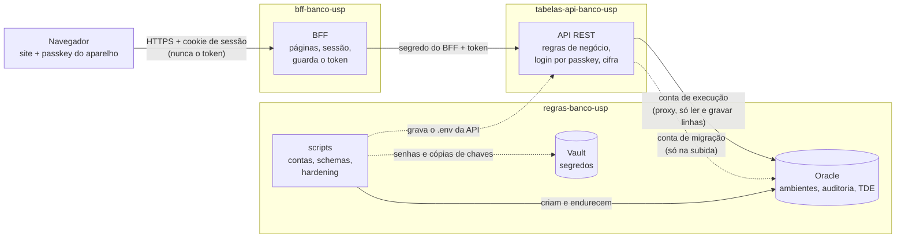

# tabelas-api-banco-usp

Tabelas de negócio e API do banco Oracle da Kawashi Sistemas, em **Java 24 + Spring Boot 4.1**.
Projeto da pós-graduação na USP.

O banco guarda **estrutura** (tipo, tamanho, formato, unicidade, chaves). Toda **regra de
negócio** mora na API. Este repositório roda sobre as regras de segurança do
`regras-banco-usp` (hardening, ambientes, perfis, auditoria, Vault): aquele define quem entra no
banco e como, este define o que existe dentro dos schemas e como se usa. Quem chama esta API é o
`bff-banco-usp`, o servidor do site (ver a seção abaixo).

## Os três repositórios do projeto

O sistema é dividido em três repositórios, um para cada camada. Cada um só precisa conhecer o
vizinho pelo que está descrito aqui; os detalhes ficam no README de cada um.

| Repositório | É responsável por | Não faz |
|---|---|---|
| [`regras-banco-usp`](https://github.com/caioteixeir4/regras-banco-usp) | O **banco Oracle e o Vault**: hardening, ambientes, contas e perfis (RBAC por proxy), auditoria, criptografia em disco (TDE) e na rede, e os schemas que a API não pode controlar (log, login e sessão). Define **quem entra no banco e o que cada conta pode fazer**. | Tabelas de negócio, API, site |
| [`tabelas-api-banco-usp`](https://github.com/caioteixeir4/tabelas-api-banco-usp) | As **tabelas de negócio** (empresa, filial, pessoa, contato, endereço) e a **API REST**: regras de negócio, cifra dos dados pessoais, login por passkey e emissão do token. Define **o que existe dentro dos schemas e como se usa**. | Contas do banco, tela; não atende o navegador |
| [`bff-banco-usp`](https://github.com/caioteixeir4/bff-banco-usp) | O **site** e o servidor dele (BFF): as páginas, o cookie de sessão e a guarda do token, que nunca chega ao navegador. Repassa à API só o que o site usa. | Regra de negócio, acesso ao banco |


Como se encaixam: `navegador → bff-banco-usp → tabelas-api-banco-usp → Oracle`, com o banco, os
schemas protegidos e o Vault montados pelo `regras-banco-usp`. O que liga cada par:

- **regras ↔ API**: o `create-api-account.ps1` (regras) cria as contas de banco da API (e, com
  `-OutEnvFile`, grava o `.env` dela); as tabelas de log, login e sessão são criadas pelas regras e só usadas pela API.
- **API ↔ BFF**: um segredo compartilhado (`BFF_SEGREDO`, gerado pelo
  `gerar-segredo-do-bff.ps1` da API nos dois `.env`). Sem ele a API não atende ninguém.
## O que já existe

- **Cadastros em torno de `PESSOA`:** `EMPRESA`, `FILIAL`, `PESSOA` (cliente, colaborador, sócio ou
  fornecedor, conforme o campo `TIPO`) e as tabelas auxiliares `CONTATO` e `ENDERECO`, que servem a
  uma filial ou a uma pessoa.
- **API REST** para todos eles (criar, listar com paginação, buscar, atualizar, excluir), com
  validações de CNPJ/CPF/UF, regras de negócio e erros no formato RFC 9457.
- **Logs da aplicação** num schema separado (`KAWASHI_ENV_<AMBIENTE>_LOG`), em que a API só insere:
  quem mudou qual registro, encadeado por hash, e cada chamada à API.
- **Login só por passkey** (desde 20/11/2026; não existe senha): a conta nasce de um convite de uso
  único, a pessoa cadastra a passkey do aparelho (digital, rosto ou PIN) e recebe 10 códigos de
  recuperação. Token opaco (15 min renovados com o uso, teto de 8 h, até 3 sessões), bloqueio por IP,
  detecção de aparelho clonado (contador). As tabelas ficam nos schemas `_LOGIN` e `_SESSAO`, criados
  pelo repositório de regras.
- **A API só atende o BFF** ([`bff-banco-usp`](https://github.com/caioteixeir4/bff-banco-usp), o servidor do site): todo pedido
  precisa de um segredo compartilhado. O token nunca chega ao navegador; ele fica guardado no BFF, e o
  navegador recebe só um cookie de sessão `HttpOnly`.
- **Autorização multiempresa** (desde 23/11/2026): cada sessão vive dentro de uma empresa, e uma
  empresa não enxerga a outra (404). Perfis por empresa (ADMINISTRADOR, OPERADOR, CONSULTA, e os que o
  administrador criar), permissão conferida em toda rota, só o administrador dá cargo, toda empresa
  com pelo menos um administrador, e um log de cada troca de cargo gravado pelo próprio banco. Empresa
  nova só pelo administrador da plataforma, que não enxerga os dados das empresas.
- **Dados pessoais protegidos (LGPD):** CPF/CNPJ de pessoa, e-mail e telefone são gravados
  **cifrados** pela API (AES-256-GCM, chave fora do banco) e saem **mascarados** nas respostas; o valor
  inteiro só por um caminho de "revelar", que fica no log de acesso. O disco do banco também é cifrado
  (TDE, no repositório de regras).
- Migrações versionadas (Flyway) e testes de integração contra o Oracle real, pelo mesmo caminho de
  produção (proxy).

Documentação:

- [`docs/modelo-de-dados.md`](docs/modelo-de-dados.md): as tabelas, os schemas e o porquê de cada
  decisão, incluindo o que ainda é proposta (aceite de termos).
- [`docs/diagrama-tabelas.html`](docs/diagrama-tabelas.html): o diagrama, campo a campo (abrir no
  navegador).
- [`docs/api-e-regras.md`](docs/api-e-regras.md): endpoints, regras, logs, concorrência.

## O que vem a seguir

Ainda não implementado:

1. **Complementos do login:** confirmação de e-mail e aceite de termos (LGPD).
2. **Dar acesso, pela API, a um usuário que já é de outra empresa** (hoje só pelo script).
3. Os itens de segurança listados em "Pendências".

## Rodando

Pré-requisitos: JDK 21 ou superior (testado com o 24), Maven 3.9 e o banco do `regras-banco-usp`
no ar (`docker compose up -d` dentro de `infra/`).

1. **Crie as duas contas da API** no repositório de regras. As duas entram no Oracle por proxy e
   vão para o mesmo `.env` local deste projeto (ignorado pelo git):

   ```powershell
   cd ..\regras-banco-usp\infra\scripts
   ./create-api-account.ps1 -Username API_TESTE_DEV_EXEC -Ambiente TESTE_DEV -OutEnvFile ..\..\..\tabelas-api-banco-usp\.env
   ./create-api-account.ps1 -Username API_TESTE_DEV      -Ambiente TESTE_DEV -Papel Migracao -OutEnvFile ..\..\..\tabelas-api-banco-usp\.env
   ```

   A primeira é a de **execução**: atende os pedidos e só lê e grava linhas. A segunda é a de
   **migração**: entra como dona das tabelas e só é usada na subida, pelo Flyway. Ver "Contas de
   banco" em [`docs/api-e-regras.md`](docs/api-e-regras.md).

2. **Gere as chaves de cifra** dos dados pessoais (uma vez só; vão para o `.env` e uma cópia para o
   Vault, nunca para a tela):

   ```powershell
   .\scripts\gerar-chaves-de-cifra.ps1
   ```

   **Perder a `CIFRA_CHAVE_DADOS` é perder os dados cifrados.** O Vault de desenvolvimento é em
   memória: depois de reiniciá-lo, reponha a cópia com `-SoCopiarParaOVault`.

3. **Gere o segredo do BFF** (vai para o `.env` daqui e para o do `bff-banco-usp`, e uma cópia para o
   Vault; nunca para a tela). Sem ele nem a API nem o BFF sobem:

   ```powershell
   .\scripts\gerar-segredo-do-bff.ps1
   ```

4. **Crie o primeiro usuário** (precisa de uma PESSOA cadastrada). Não há senha: o usuário recebe um
   **link de convite** de uso único (24 h), que vai para o Vault e não aparece na tela. No link, a
   pessoa cadastra a passkey e recebe os códigos de recuperação. Quem perdeu tudo ganha um convite
   novo com `-UsuarioId`:

   ```powershell
   .\scripts\criar-usuario.ps1 -PessoaId 42 -Email voce@empresa.com.br
   ```

5. **Suba a API** (as migrações rodam sozinhas na primeira vez):

   ```bash
   mvn spring-boot:run
   ```

6. **Rode os testes** (todos, contra o Oracle real):

   ```bash
   mvn test
   ```

7. **HTTPS** (opcional no desenvolvimento, obrigatório fora dele). Gera um certificado autoassinado
   para `localhost` e liga o HTTPS obrigatório no `.env`:

   ```powershell
   .\scripts\gerar-certificado-dev.ps1
   ```

   Depois disso a API sobe em `https://localhost:8080` e recusa HTTP puro. Os testes não são
   afetados: eles fixam a própria configuração de HTTPS.

Configuração, por variável de ambiente ou pelo `.env`:

| Variável | Para quê | Padrão |
|---|---|---|
| `DB_URL` | URL JDBC | `jdbc:oracle:thin:@//localhost:1521/FREEPDB1` |
| `DB_SCHEMA` | Schema do ambiente, onde ficam as tabelas (`KAWASHI_ENV_<AMBIENTE>`) | sem padrão |
| `DB_USER` | Conta de **execução**, no formato `CONTA[KAWASHI_ENV_<AMBIENTE>_APP]` | sem padrão |
| `DB_PASSWORD` | Senha da conta de execução | sem padrão |
| `DB_MIGRACAO_USER` | Conta de **migração**, no formato `CONTA[KAWASHI_ENV_<AMBIENTE>]` | sem padrão |
| `DB_MIGRACAO_PASSWORD` | Senha da conta de migração | sem padrão |
| `DB_POOL_MAX` | Tamanho máximo do pool de conexões | `10` |
| `PORT` | Porta | `8080` |
| `EXIGIR_HTTPS` | `true` recusa pedido a `/api/**` que não chegou por HTTPS | `false` |
| `SSL_ATIVO`, `SSL_KEYSTORE`, `SSL_KEYSTORE_PASSWORD` | HTTPS direto na aplicação (keystore PKCS12) | desligado |
| `BFF_SEGREDO` | Segredo compartilhado com o BFF (cabeçalho `X-Kawashi-Bff`), pelo menos 32 caracteres. Sem ele a API não sobe | sem padrão |
| `WEBAUTHN_RP_ID` | Domínio do **site** (do BFF) para as passkeys. Trocar o domínio invalida as passkeys cadastradas | `localhost` |
| `WEBAUTHN_ORIGENS` | Endereços exatos de onde o navegador faz a cerimônia, separados por vírgula | `http://localhost:9090` |
| `WEBAUTHN_RP_NOME` | Nome que o aparelho mostra | `Kawashi` |
| `CIFRA_CHAVE_DADOS`, `CIFRA_CHAVE_INDICE` | Chaves (32 bytes em base64) que cifram os dados pessoais e geram a impressão digital deles. Sem elas a API não sobe | sem padrão |

As senhas também ficam no Vault, em `kawashi-secrets/api/<conta>`. O schema de log é deduzido
sozinho (`DB_SCHEMA` seguido de `_LOG`). A saúde da aplicação fica em `/actuator/health`.

## O banco guarda estrutura, a API guarda regra

| O banco garante | A API garante |
|---|---|
| Tipo, tamanho máximo e `NOT NULL` de cada coluna | Mensagem clara em português para cada campo inválido (400) |
| Formato (`CHECK`): CNPJ com 14 dígitos, CPF com 11, UF com 2 letras, CEP com 8 | Dígito verificador de CNPJ e CPF, UF que existe de verdade, e-mail e telefone válidos |
| Os valores possíveis de `TIPO` e `NATUREZA`; participação só em sócio, cargo só em colaborador | Participação obrigatória para sócio; soma das participações até 100% |
| Unicidade (`UNIQUE`) e chaves estrangeiras; contato e endereço com exatamente um dono | Duplicidade (409), pai inexistente (404), registro com dependentes (409) |
| Nada além disso | Pai inativo não recebe filho novo, só a matriz é empresa, filial herda a raiz do CNPJ, um único principal, imutabilidade de documento e tipo |

Se uma restrição do banco for violada sem que a API a tenha antecipado, o cliente recebe um 409
genérico e o log guarda a causa real. As regras importantes são checadas antes, na camada de
serviço, com mensagem própria.

## Migrações (Flyway)

Ficam em `src/main/resources/db/migration`. A regra é a do Flyway: **uma migração aplicada nunca é
editada**; qualquer mudança de estrutura é uma migração nova. O Hibernate roda com
`ddl-auto=validate`: ele só confere se as entidades batem com as tabelas, e a aplicação não sobe se
não baterem.

- `V1` a `V4`: o primeiro modelo (uma tabela por papel: `CLIENTE`, `SOCIO`...).
- `V5`: troca pelo modelo em torno de `PESSOA`. Ela **não converte dados**: recusa rodar se alguma
  tabela antiga tiver linhas, em vez de apagar em silêncio. O modelo antigo só existiu em
  desenvolvimento.
- `V6`: CPF/CNPJ da pessoa e valor do contato passam a ser guardados cifrados (`DOCUMENTO_CIFRADO` +
  `DOCUMENTO_INDICE`, `VALOR_CIFRADO` + `VALOR_INDICE`). Também **não converte dados** (cifrar exige a
  chave, que o banco não tem): recusa rodar se `PESSOA` ou `CONTATO` tiverem linhas.

As tabelas de **log não são criadas aqui**, e sim pelo repositório de regras
(`infra/oracle-init/11_schema_log.sql`). É de propósito: quem cria uma tabela é dono dela e consegue
apagar as linhas. Com o dono sendo um schema em que ninguém loga, "a API só insere no log" deixa de
ser promessa e vira permissão do banco.

## Testes

Testes de integração sobem a aplicação inteira, conectam no Oracle real como conta de API (por
proxy) e chamam os endpoints por MockMvc. Cada teste roda numa transação que é desfeita no fim,
então não sobra dado no banco e os testes não interferem entre si. Os documentos usados são
CNPJ/CPF válidos e aleatórios (`GeradorDeDocumentos`), nunca reais.

A suíte tem **165 testes** (última execução de `mvn clean test`, 23/11/2026, todos passando). Toda
chamada à API nos testes finge vir do BFF (`testes/Api` manda o segredo de teste e um IP de navegador)
e vai com token: `testes/UsuarioDeTeste` cria a empresa, os perfis, o usuário e o vínculo de
ADMINISTRADOR (dentro da transação do teste, que é desfeita) e emite o token preso à empresa. Cada
`api.empresa()` cria outra empresa do mesmo usuário e troca a sessão para ela pela rota real
`/api/auth/empresa`, então todo teste passa pelo isolamento de verdade. A cerimônia de passkey de verdade é testada com `testes/AutenticadorDeTeste`, um
"aparelho" em Java que gera a chave P-256, monta o CBOR e assina como um autenticador real; a API o
verifica com o WebAuthn4J sem atalho nenhum. É menor que a do modelo antigo (296): são menos tabelas,
e os testes foram reescritos mais densos, vários casos por teste.

| Grupo | Testes |
|---|---|
| `EmpresaEFilialApiTest` (a plataforma cria a empresa com o primeiro administrador e não enxerga os dados; administrador de empresa não usa as rotas da plataforma; cada sessão só vê a sua empresa; filiais) | 12 |
| `AutorizacaoApiTest` (nenhuma rota sem regra; cadastros de outra empresa dão 404 em todas as rotas; CONSULTA só lê, OPERADOR não revela nem mexe em usuários; sem empresa só dá para escolher; troca de cargo vale na hora e fica no log com de/para e quem; a empresa nunca fica sem administrador; desativar tira o acesso, inclusive por outro caminho; perfis editáveis menos o ADMINISTRADOR e as permissões exclusivas) | 13 |
| `PessoaApiTest` (tipos, natureza e documento, participação, soma dos sócios) | 15 |
| `ContatoEEnderecoApiTest` (as mesmas regras com dono filial e dono pessoa) | 12 |
| `LogDaAplicacaoTest` (rastro de cada mudança, encadeamento, o que a API não consegue fazer no log) | 7 |
| `ServidorRealTest` (porta real: 12 pedidos simultâneos contra as travas e contra o log, corpo fragmentado) | 8 |
| `DocumentosTest` (CNPJ, CPF, UF, sem banco) | 31 |
| `ConexaoProxyTest` (as duas contas de banco; a de execução não cria, altera nem apaga tabela) | 6 |
| `PasskeyApiTest` (com a sessão do banco forçada em −05:00: convite, entrar, desafio de uso único e desafio vencido, token vencido, origem e domínio conferidos, verificação da pessoa exigida, clone com a mesma credencial, contador que volta, código de recuperação só para cadastrar passkey, remoção derruba as sessões da passkey, sair, bloqueio por IP, a exigência do BFF) | 28 |
| `ConexaoCifradaTest` (o banco exige cifra: a conexão normal funciona, um cliente que recusa cifrar é barrado com `ORA-12660`) | 3 |
| `HttpsObrigatorioTest` (HTTP puro recusado, cabeçalhos de segurança) | 4 |
| `TratadorDeErrosTest` | 2 |
| `CifraDeDadosTest` (cifra, impressão digital, adulteração, chave errada, máscaras; sem banco) | 11 |
| `DadosPessoaisCifradosTest` (o que fica na tabela, unicidade pela impressão digital, máscara, revelar com rastro, cifra adulterada por fora) | 13 |

O `ServidorRealTest` é a exceção à transação desfeita: precisa gravar de verdade para disputar as
travas. Ele usa um usuário e uma empresa **fixos** (criados na primeira execução), porque perfis e
vínculos não se apagam; apaga os cadastros que criou dentro dela, e as linhas de log ficam, porque a
API não tem como apagá-las.

**Preparo único para os testes da plataforma:** o usuário fixo (`servidor-real@teste.kawashi.invalid`)
precisa ser administrador da plataforma, e isso só se concede pelo banco. Rode uma vez, no repositório
de regras, `infra/scripts/conceder-admin-plataforma.ps1 -Ambiente TESTE_DEV -UsuarioId <id> -Motivo
"testes da plataforma"`. Sem isso, os testes da plataforma falham dizendo o que rodar.

Como a transação do teste mantém a sessão aberta, ela esconde um tipo de erro de produção. Por isso
existe também um roteiro por **HTTP real**, [`scripts/smoke-http.ps1`](scripts/smoke-http.ps1): com
a API no ar, trabalha dentro da empresa da sessão da conta de teste (filial, pessoas de cada tipo,
contatos e endereços), cria empresas pela plataforma e confere que não enxerga os dados delas, viola
as regras de propósito (56 verificações na primeira rodada, 54 nas seguintes, incluindo a exigência do
BFF, login por passkey, desafio de uso único, isolamento entre empresas, perfis, máscara, revelar e
logout), apaga os cadastros que criou e inativa as empresas criadas (empresa com perfis não se apaga).

```bash
PORT=18080 mvn spring-boot:run          # em um terminal
```

```powershell
.\scripts\criar-usuario.ps1 -PessoaId 42 -Email smoke@teste.kawashi.invalid   # só na primeira vez
.\scripts\smoke-http.ps1 -Base http://localhost:18080 -UsuarioId 7
```

O roteiro fala com a API como o BFF (lê o `BFF_SEGREDO` do `.env`, sem mostrar) e entra com uma
**passkey de software** ([`scripts/passkey-de-software.ps1`](scripts/passkey-de-software.ps1)) de uma
conta de teste. Na primeira vez ele lê o convite do Vault, cadastra a passkey e guarda a chave no
Vault (`kawashi-secrets/smoke-passkey/<AMBIENTE>/<usuario>`); nas seguintes, entra com ela. Passkey de
software só serve para conta de teste do desenvolvimento: a chave fica no Vault, e não presa num
aparelho. No fim faz logout e confere que o token parou de valer. A conta precisa ter acesso a uma
empresa (a do `ServidorRealTest`) e, para a parte da plataforma, ser administradora da plataforma.
Última execução: 23/11/2026, 56 ok e depois 54 ok, contra a conta fixa de teste (usuário 108 do
`TESTE_DEV`). O Vault de desenvolvimento esquece a chave da passkey de software quando reinicia:
depois disso, gere um convite novo (`criar-usuario.ps1 -UsuarioId 108`) e o roteiro cadastra outra.

## Armadilhas encontradas pelo caminho

- **Spring Boot 4 mudou classes de pacote.** Por exemplo, `PropertyReferenceException` passou para
  `org.springframework.data.core` e `AutoConfigureMockMvc` para
  `org.springframework.boot.webmvc.test.autoconfigure`. Em caso de dúvida, listar as entradas do jar
  em vez de adivinhar.
- **`open-in-view` está desligado**, e os controladores montam a resposta depois que a transação do
  serviço fechou. Por isso as entidades guardam o pai só pela chave (`empresaId`, `filialId`,
  `pessoaId`), sem associação JPA: nada na resposta depende de carga preguiçosa.
- **O Oracle mede `VARCHAR2(n)` em bytes por padrão**, e o banco é `AL32UTF8`: letra acentuada
  ocupa 2 bytes. As colunas de texto livre são `VARCHAR2(n CHAR)`.
- **Falta de privilégio tem dois códigos.** Pelo `sqlplus` aparece `ORA-01031`; pelo JDBC do Oracle
  23, o mais específico `ORA-41900`. Os testes aceitam os dois.
- **Com o BFF na frente, o IP da conexão é sempre o do BFF.** Se a API bloqueasse por ele, uma pessoa
  errando bloquearia todo mundo. O BFF manda o IP do navegador em `X-Kawashi-Ip-Cliente`, e a API só
  acredita nesse cabeçalho depois de conferir o segredo (senão qualquer um inventaria o próprio IP).
- **O PowerShell 5.1 atrapalha quem passa segredo para o Vault.** Pela entrada padrão ele põe um BOM
  na frente; em argumento ele estraga aspas duplas. Os scripts passam o valor por variável de
  ambiente (`docker exec -e NOME`, sem `=valor`), que não aparece nem na linha de comando.
- **Duas transações na mesma thread se travam para sempre.** Cada teste roda numa transação, e criar
  um usuário grava no log encadeado, o que trava a linha de controle da corrente até o fim do teste.
  Um apoio de teste que abria uma segunda transação (`REQUIRES_NEW`) para gravar no mesmo log ficava
  esperando a primeira, que esperava ele: a suíte parava sem erro. O apoio passou a só ler.
- **A prova pelo avesso acha teste que falta.** Quebrar a checagem do vínculo dentro do token não
  derrubou nenhum teste: desativar pela API também revoga as sessões, então a checagem nunca era
  exercitada. Entrou o teste do vínculo desativado direto no banco.
- **O Maven não recompila um arquivo restaurado com a data antiga.** Ao conferir um teste quebrando o
  código de propósito, restaurar o arquivo com `mv` do backup deixou a classe quebrada compilada. Depois
  de restaurar, `touch` no arquivo (ou `mvn clean`).

## Pendências

- **Complementos do login** (ver "O que vem a seguir").
- **O log de alteração não guarda o valor antigo nem o novo**, só que o registro mudou.
- Empacotamento (Dockerfile) e integração contínua.

## Origem

O conteúdo inicial saiu do `regras-banco-usp` na separação entre regras e tabelas. A versão
completa de antes da separação está na tag `dominio-completo-pre-separacao` (commit `cadb773`)
daquele repositório. O primeiro modelo de tabelas e sua API estão no histórico do git deste
repositório, até o commit `49913a6`.
