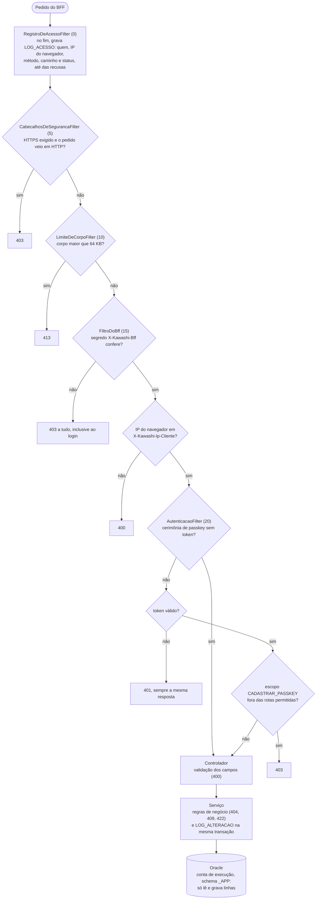
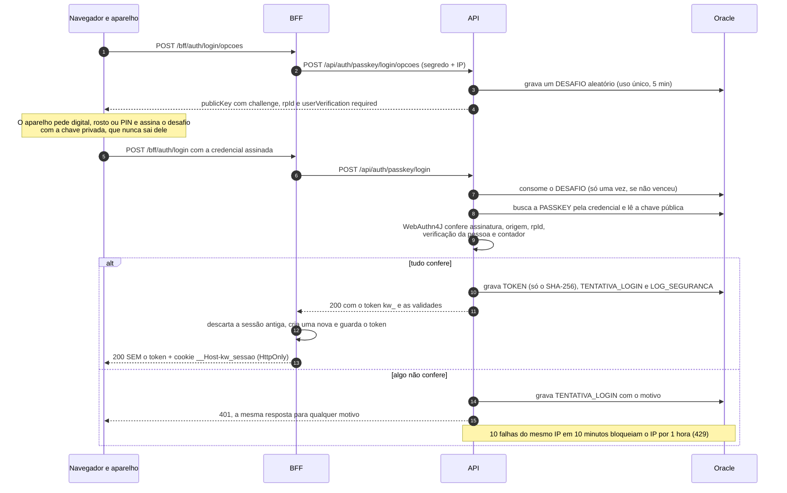
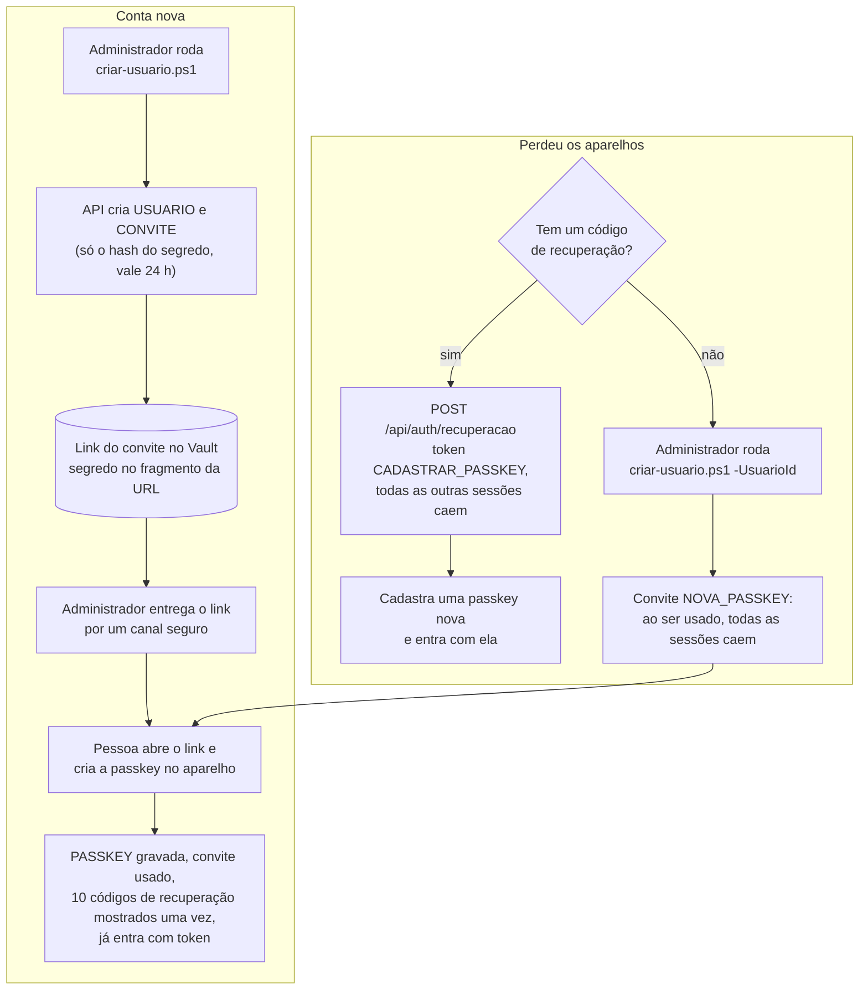
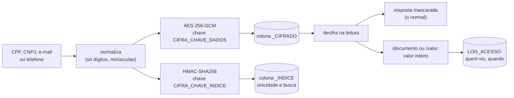

# API e regras de negócio

Referência da API de cadastros: endpoints, regras e as decisões de interpretação tomadas. A
estrutura das tabelas está nas migrações `V5` e `V6` (`src/main/resources/db/migration`) e desenhada em
[`diagrama-tabelas.html`](diagrama-tabelas.html); o porquê do modelo está em
[`modelo-de-dados.md`](modelo-de-dados.md). Aqui está o que a API faz por cima das tabelas.

## Convenções

- **Só o BFF chama a API:** todo pedido leva o segredo `X-Kawashi-Bff` e o IP do navegador em
  `X-Kawashi-Ip-Cliente`; sem o segredo, `403` a tudo. Ver "Login" abaixo.
- **Login obrigatório:** toda a `/api` exige `Authorization: Bearer <token>`, menos as cerimônias de
  passkey que levam a um token. Sem token, ou com token vencido, revogado ou inválido: `401`, sempre
  com a mesma mensagem. Token na URL é recusado.
- **Caminho base:** `/api`. JSON em UTF-8. Datas em ISO-8601, em UTC e sem fuso (`criadoEm`,
  `atualizadoEm`).
- **Status:** `201` com header `Location` ao criar, `204` ao excluir, `400` para campo inválido,
  `404` para registro que não existe, `409` para duplicidade ou registro com dependentes, `413`
  para corpo grande demais, `422` para regra de negócio violada.
- **Erros** no formato RFC 9457 (`application/problem+json`). Validação de campos devolve a lista
  em `erros`:

  ```json
  {
    "title": "Dados inválidos",
    "status": 400,
    "detail": "Um ou mais campos não passaram na validação.",
    "erros": [{ "campo": "documento", "mensagem": "CPF inválido" }]
  }
  ```

- **Paginação:** `?page=0&size=20&sort=campo,asc` (páginas começam em 0, `size` vai até 100).
  Resposta: `{ "itens": [...], "pagina": 0, "tamanho": 20, "total": 3, "totalPaginas": 1 }`.
  Ordenar por campo que não existe devolve `400`, e `page` grande demais também, em vez de `500`.
  Toda listagem tem desempate por `id`, então a ordem é estável.
- **`PUT` é substituição completa**: o corpo traz todos os campos editáveis. Opcionais omitidos
  viram nulos, e `principal` omitido vale `false`.
- **Normalização na entrada:** todo texto é aparado antes de validar; CNPJ, CPF, CEP e telefone
  aceitam pontuação e são gravados só com dígitos; e-mail em minúscula; UF, tipo e natureza em
  maiúscula; texto opcional em branco vira nulo.

## Caminho de um pedido

Todo pedido a `/api/**` passa pelos filtros nesta ordem (o número é o `@Order`), e cada um pode
recusar antes do seguinte. Só chega ao controlador o que passou por todos.


## Endpoints

| Recurso | Endpoints |
|---|---|
| Login (passkey) | sem token: `POST /api/auth/passkey/login/opcoes`, `POST /api/auth/passkey/login`, `POST /api/auth/convite/opcoes`, `POST /api/auth/convite`, `POST /api/auth/recuperacao`. Com token: `GET /api/auth/eu`, `GET/POST /api/auth/passkeys`, `POST /api/auth/passkeys/opcoes`, `DELETE /api/auth/passkeys/{id}`, `POST /api/auth/codigos-de-recuperacao`, `POST /api/auth/logout`, `POST /api/auth/sair-de-todos` |
| Empresa | `POST /api/empresas`, `GET /api/empresas` (filtros `cnpj`, `razaoSocial`, `ativa`), `GET/PUT/DELETE /api/empresas/{id}`, `POST /api/empresas/{id}/inativar`, `POST /api/empresas/{id}/reativar` |
| Filial | `POST/GET /api/empresas/{empresaId}/filiais`, `GET/PUT/DELETE /api/filiais/{id}`, `POST /api/filiais/{id}/inativar`, `POST /api/filiais/{id}/reativar` |
| Pessoa | `POST/GET /api/empresas/{empresaId}/pessoas` (filtros `tipo`, `ativa`), `GET/PUT/DELETE /api/pessoas/{id}`, `GET /api/pessoas/{id}/documento` (revela o documento inteiro), `POST /api/pessoas/{id}/inativar`, `POST /api/pessoas/{id}/reativar` |
| Contato | `POST/GET /api/filiais/{filialId}/contatos`, `POST/GET /api/pessoas/{pessoaId}/contatos`, `GET/PUT/DELETE /api/contatos/{id}`, `GET /api/contatos/{id}/valor` (revela o valor inteiro) |
| Endereço | `POST/GET /api/filiais/{filialId}/enderecos`, `POST/GET /api/pessoas/{pessoaId}/enderecos`, `GET/PUT/DELETE /api/enderecos/{id}` |

Criar e listar são aninhados no pai (a empresa, ou o dono do contato e do endereço). Operar sobre
um registro específico usa o caminho plano, já que o id basta.

## Regras por tabela

### Empresa
- CNPJ válido (dígitos verificadores), normalizado, único (`409`) e **imutável** (`422` se o `PUT`
  trouxer outro).
- A empresa é sempre a **matriz**: o CNPJ precisa ter ordem `0001` (dígitos 9 a 12), senão `422`
  explicando que filiais se cadastram em `/api/empresas/{id}/filiais`.
- Excluir empresa que tem filiais ou pessoas dá `409` dizendo quantas são. O caminho é inativar.

### Filial
- A empresa precisa existir (`404`) e estar **ativa** (`422`).
- A filial compartilha a **raiz** do CNPJ (8 primeiros dígitos) com a empresa (`422` se for outra),
  e a ordem não pode ser `0001`, que é a matriz (`422`).
- CNPJ único (`409`) e imutável (`422`); só o nome muda.
- Excluir filial que tem contatos ou endereços dá `409`.

### Pessoa
Toda pessoa pertence a uma empresa. O papel dela fica no campo `tipo`, e não em uma tabela por
papel.

- `tipo`: `CLIENTE`, `COLABORADOR`, `SOCIO` ou `FORNECEDOR` (`400` fora da lista).
- `natureza`: `F` (pessoa física) ou `J` (jurídica). O `documento` precisa ser um CPF válido para
  `F` e um CNPJ válido para `J`; o erro sai no campo `documento` (`400`).
- A empresa precisa existir (`404`) e estar **ativa** (`422`).
- O documento é único **por empresa e por tipo** (`409`). A mesma pessoa pode ter dois tipos na
  mesma empresa, ou aparecer em duas empresas: são cadastros separados.
- `tipo`, `natureza` e `documento` são **imutáveis** (`422`). No `PUT`, o documento pode vir
  completo ou como a **máscara** que a API devolveu (vale por "o mesmo"); a máscara de outro documento
  dá `422`. No cadastro, documento mascarado dá `400`.
- O documento sai **mascarado** nas respostas (`***.982.247-**`, `**.222.333/0001-**`), inclusive na
  mensagem de conflito. Inteiro, só em `GET /api/pessoas/{id}/documento`.
- `participacao` (0,01 a 100, até 2 casas) é **obrigatória para sócio** e proibida nos demais
  (`422`). A **soma** das participações dos sócios de uma empresa não passa de 100% (`422`, a
  mensagem diz quanto ainda está disponível). No `PUT` a soma desconta o próprio sócio.
- `cargo` é opcional e só existe para **colaborador** (`422` nos demais).
- Excluir pessoa que tem contatos ou endereços dá `409`.

### Contato e endereço (tabelas auxiliares)
Servem a uma **filial** ou a uma **pessoa**. O dono vem do caminho e nunca muda; a resposta traz
`filialId` ou `pessoaId`, exatamente um preenchido.

- O dono precisa existir (`404`) e estar **ativo** para receber um novo (`422`).
- **Contato:** `tipo` é `EMAIL` ou `TELEFONE`, e o `valor` precisa combinar: um e-mail, ou um
  telefone com DDD de 10 ou 11 dígitos (aceita `(11) 98765-4321`). Erro no campo `valor` (`400`).
  O tipo não muda (`422`). O mesmo valor não se repete no mesmo dono (`409`), e o banco também
  garante isso (índice único sobre a impressão digital).
- O valor do contato sai **mascarado** (`f***@exemplo.com.br`, `(11) *****-4321`); inteiro, só em
  `GET /api/contatos/{id}/valor`. No `PUT`, devolver a máscara mantém o valor (dá para trocar só o
  `principal` sem conhecer o contato); máscara de outro valor dá `400`; no cadastro, valor mascarado
  dá `400`.
- **Endereço:** UF existente (as 27) e CEP com 8 dígitos (aceita `12345-678`).
- **Principal:** o **primeiro** endereço do dono é sempre o principal, mesmo que o pedido diga
  `false`. Para contato a regra vale **por tipo**: um e-mail principal e um telefone principal.
- No máximo **um** principal: marcar outro como principal rebaixa o anterior, na mesma transação.
- Um dono com registros nunca fica sem principal: desmarcar o principal atual dá `422`, e excluí-lo
  enquanto houver outros (do mesmo tipo, no contato) também. Excluir o único é permitido.

## Decisões de interpretação

Todas cobertas por teste.

- **"Pai ativo" vale só para criar.** Atualizar e excluir continuam permitidos em registro cujo pai
  (ou dono) está inativo; a regra restringe o cadastro novo.
- **Principal e `PUT`.** Como `principal` omitido vale `false`, editar o registro **principal
  atual** exige mandar `principal: true`. Para trocar o principal, marca-se outro.
- **Listar filhos de um pai que não existe** devolve `404`, não lista vazia.
- **Inativar e reativar são idempotentes** (repetir devolve `200` e não gera novo log).
- **Ordem das verificações na criação:** campos (`400`), pai existe (`404`), pai ativo (`422`),
  regras do próprio registro (`422`), duplicidade (`409`) e, para sócio, por último a soma das
  participações (`422`). Um sócio repetido que também estouraria os 100% recebe `409`.
- **Filtro por razão social** é "contém", sem diferenciar maiúscula de minúscula, e trata `%` e
  `_` como texto comum.

## Logs da aplicação

Ficam em outro schema, `KAWASHI_ENV_<AMBIENTE>_LOG`, cujas tabelas são criadas pelo repositório de
regras. Só a conta de execução da API tem acesso a ele, e só `INSERT` e `SELECT`.

- **`LOG_ALTERACAO`**: toda criação, alteração e exclusão de cadastro gera uma linha (tabela, id,
  ação), gravada na **mesma transação** da mudança: mudança desfeita não deixa log, e não existe
  mudança gravada sem log. Pedido recusado não gera linha.
- **`LOG_ACESSO`**: cada chamada a `/api/**` (quem, IP do navegador repassado pelo BFF, método,
  caminho, status). Só o caminho entra, nunca a query string nem o corpo.
- **Encadeamento:** um gatilho do banco numera cada linha de `LOG_ALTERACAO` sem buraco, carimba a
  hora do servidor e grava um hash que inclui o da linha anterior. A API não escolhe nenhum desses
  valores. A view `V_LOG_ALTERACAO_QUEBRAS` devolve as linhas com problema (vazia = corrente
  inteira).
- O campo `USUARIO` dos dois logs é `USUARIO:<id>` do token (vazio no `LOG_ACESSO` de pedido sem token).

O que a API tenta e não consegue (`LogDaAplicacaoTest`): alterar ou apagar linhas de log
(`ORA-41900`, falta o privilégio) e enxergar a tabela de controle da corrente (`ORA-00942`).

**Custo conhecido:** o gatilho trava a linha de controle até o fim da transação de quem insere,
então as gravações de um mesmo ambiente são feitas uma de cada vez. Os serviços registram o log
por último, para a trava durar o mínimo.

## Login

Só por **passkey** (WebAuthn): não existe senha. Detalhes e o porquê de cada escolha em "Login por
passkey", em [`modelo-de-dados.md`](modelo-de-dados.md). Os números ficam em `PARAMETRO_SEGURANCA` (a
API só lê). A verificação criptográfica é da biblioteca WebAuthn4J (`login/Passkeys`).

### Quem chama: só o BFF

A API não atende o navegador. Quem chama é o **BFF** (repositório `bff-banco-usp`, o servidor do
site), e todo pedido a `/api/**` precisa de dois cabeçalhos (`FiltroDoBff`):

| Cabeçalho | Sem ele |
|---|---|
| `X-Kawashi-Bff`: o segredo compartilhado (`BFF_SEGREDO`, 32+ caracteres, comparado em tempo constante) | `403` a tudo, inclusive ao login |
| `X-Kawashi-Ip-Cliente`: o IP do navegador | `400`. Com o BFF na frente, o IP da conexão é sempre o dele; sem o IP real, o bloqueio por IP pegaria todo mundo de uma vez. A API só acredita nesse cabeçalho **depois** de conferir o segredo |

O token também só circula entre o BFF e a API: o navegador recebe um cookie de sessão `HttpOnly` e
nunca vê o token (um script malicioso na página não tem o que roubar). Em produção, a API também não
deve ser alcançável pela rede de fora; o segredo é a segunda barreira.

### Cerimônias sem token

As respostas de passkey (`credencial`) são o `PublicKeyCredential.toJSON()` do navegador, como veio.

| Pedido | Resposta |
|---|---|
| `POST /api/auth/passkey/login/opcoes` | `200` `{ "publicKey": {...} }`: desafio novo (uso único, 5 min), `userVerification: required`, sem lista de credenciais (o aparelho mostra as contas que tem) |
| `POST /api/auth/passkey/login` `{ "credencial" }` válida | `200` `{ "token": "kw_...", "tipo": "Bearer", "escopo": "COMPLETO", "expiraEm": "...Z", "expiraAbsolutoEm": "...Z" }` |
| credencial desconhecida, assinatura que não confere, desafio inventado/usado/vencido, outra origem ou outro domínio, aparelho que não verificou a pessoa, usuário desligado | `401`, **a mesma** mensagem. O motivo vai só para `TENTATIVA_LOGIN` |
| contador de assinaturas que volta (aparelho clonado) | `401`, e um `CONTADOR_SUSPEITO` no `LOG_SEGURANCA` |
| `POST /api/auth/convite/opcoes` `{ "convite" }` | `200` com as opções de cadastro (`residentKey: required`, `attestation: none`, ES256 ou RS256). Convite inválido, usado ou vencido: `401` |
| `POST /api/auth/convite` `{ "convite", "nome", "credencial" }` | `200` com o token e `codigosDeRecuperacao` (10, **mostrados uma única vez**). O convite deixa de valer. Se era um convite de recuperação, todas as sessões antigas caem |
| `POST /api/auth/recuperacao` `{ "email", "codigo" }` | `200` com um token de escopo `CADASTRAR_PASSKEY`: só serve para ver e cadastrar passkeys, `logout` e `eu` (o resto dá `403`). O código deixa de valer e as outras sessões caem. Código aceito com ou sem traços, em qualquer caixa |
| 10 falhas do mesmo IP em 10 minutos (em qualquer cerimônia) | `429` com `Retry-After`: o IP fica bloqueado por 1 hora |

O segredo do convite vai no **corpo**, nunca no caminho: o `LOG_ACESSO` grava o caminho.

Como o login acontece, do botão "Entrar" ao token. O BFF só repassa: quem decide é a API.



### Com token

| Pedido | Resposta |
|---|---|
| `GET /api/auth/eu` | `200` `{ usuarioId, pessoaId, escopo, expiraEm, expiraAbsolutoEm }` |
| `GET /api/auth/passkeys` | `200` lista `{ id, nome, criadaEm, ultimoUsoEm, sincronizada }` (horas em UTC com `Z`; nada da chave) |
| `POST /api/auth/passkeys/opcoes` e `POST /api/auth/passkeys` `{ "nome", "credencial" }` | `201` `{ id, nome }`. Aparelho já cadastrado, resposta que não confere ou limite de 10 passkeys: `422` |
| `DELETE /api/auth/passkeys/{id}` | `204`, e as sessões abertas com essa passkey caem. A última passkey não pode ser removida (`422`); passkey de outra pessoa: `404` |
| `POST /api/auth/codigos-de-recuperacao` | `200` `{ "codigos": [...] }`: 10 novos; os anteriores deixam de valer |
| `POST /api/auth/logout` | `204`: este token para de valer na hora |
| `POST /api/auth/sair-de-todos` | `204`: todas as sessões do usuário caem |
| quarta sessão do mesmo usuário | a mais antiga cai |

O token só é aceito em `Authorization: Bearer`; token na URL é recusado. Token ausente, inválido,
vencido ou revogado recebem a mesma resposta `401`. Ele vale 15 minutos, é renovado com o uso, até 8
horas depois do login. Os logs dizem quem fez: `LOG_ACESSO.USUARIO` e `LOG_ALTERACAO.USUARIO` gravam
`USUARIO:<id>`.

### Criar usuário

Ainda não há endpoint (criar usuário será de administrador, com a autorização). O caminho é o
`scripts/criar-usuario.ps1`: cria o usuário com um convite de uso único (24 h) e guarda o link
(`<site>/convite.html#kwc_...`) no Vault, sem mostrar. O segredo vai depois do `#`, que o navegador
nunca manda ao servidor; a página do convite o tira da barra de endereço assim que o lê.

Como uma conta nasce e como volta quem perdeu os aparelhos:



**Ainda sem autorização:** todo usuário logado pode tudo, inclusive revelar CPF e e-mail. Perfis,
permissões e o vínculo com cada empresa são a etapa 4.
## Dados pessoais: cifra e máscara

O documento da pessoa e o valor do contato **nunca chegam ao banco em claro**. A API cifra antes de
gravar (`CifraDeDados`, AES-256-GCM) e guarda ao lado uma impressão digital (HMAC-SHA256 com outra
chave), que é o que o banco usa para a unicidade. As chaves (`CIFRA_CHAVE_DADOS`,
`CIFRA_CHAVE_INDICE`) ficam com a aplicação; sem elas a API não sobe. O detalhe e o porquê estão em
"Criptografia e LGPD", em [`modelo-de-dados.md`](modelo-de-dados.md).



O banco nunca vê o valor em claro; o disco dele ainda é cifrado por baixo (TDE, no repositório de
regras).

| Situação | Resposta |
|---|---|
| Ler pessoa ou contato | valor **mascarado** |
| `GET /api/pessoas/{id}/documento`, `GET /api/contatos/{id}/valor` | valor inteiro; o pedido fica no `LOG_ACESSO` (quem viu o quê e quando) |
| Cifra alterada ou copiada de outra coluna direto no banco | `500`, sem conteúdo na resposta: a cifra autenticada não deixa devolver um valor adulterado |
| Texto em claro gravado direto na coluna cifrada | recusado pelo banco (`CHECK`) |

Quando a autorização existir, os dois caminhos de revelar ganham uma permissão própria.

## Contas de banco e transporte

### Duas contas de banco

Quem entra por proxy no schema do ambiente age como o **dono** das tabelas, e o dono sempre pode
apagá-las. Por isso a API usa duas contas, criadas por `create-api-account.ps1 -Papel` no
repositório de regras:

| Conta | Entra em | Quando é usada | O que consegue |
|---|---|---|---|
| **Migração** | `KAWASHI_ENV_<AMBIENTE>` (o dono) | só na subida, pelo Flyway | criar e alterar tabelas |
| **Execução** | `KAWASHI_ENV_<AMBIENTE>_APP` (schema sem objetos) | em todo pedido | ler e gravar linhas, e inserir no log |

Depois de cada migração, o próprio Flyway (`afterMigrate.sql`) concede à conta de execução só
`SELECT`, `INSERT`, `UPDATE` e `DELETE` em cada tabela. Quem invadir a API herda a conta de
execução: não consegue `DROP`, `ALTER`, `TRUNCATE` nem `CREATE` (testado em `ConexaoProxyTest`), não
consegue alterar nem apagar o log, e não lê o histórico das migrações.

O que a separação **não** resolve: a conta de execução ainda lê e altera todas as linhas de
cadastro. Limitar isso por usuário e por empresa é papel do login e da autorização.

### Conexão com o banco cifrada

O servidor Oracle exige cifra AES-256 e conferência SHA-256 em toda conexão pela rede (repositório
de regras, `infra/scripts/apply-network-hardening.ps1`). O driver JDBC negocia sozinho: **nada muda
na configuração da API**. Um cliente que se recuse a cifrar é barrado com `ORA-12660`
(`ConexaoCifradaTest`). Assim, os dados também vão cifrados entre a API e o banco, e não só entre
quem chama e a API (HTTPS).

### Troca da senha do banco sem parar a API

A senha das duas contas é trocada por `infra/scripts/rotate-api-password.ps1` no repositório de
regras, que atualiza o Oracle, o Vault e a linha certa deste `.env`. O Oracle aceita a senha antiga
e a nova juntas por até 1 dia (troca gradual), então a API que está rodando continua conectando
até ser reiniciada com a senha nova.

### HTTPS e cabeçalhos

- **HTTPS obrigatório** com `EXIGIR_HTTPS=true`: pedido a `/api/**` que chegou em HTTP puro recebe
  `403` sem ser processado (e fica registrado no `LOG_ACESSO`). A checagem de saúde continua
  acessível. Fica desligado só no desenvolvimento e nos testes.
- **HTTPS direto na aplicação** com `SSL_ATIVO=true` e um keystore PKCS12; o
  `scripts/gerar-certificado-dev.ps1` gera um autoassinado para desenvolvimento. Atrás de um proxy
  reverso que termina o TLS, vale o cabeçalho `X-Forwarded-Proto`, aceito só de proxies internos.
- **Toda resposta leva**: `Cache-Control: no-store` (a resposta carrega dado pessoal),
  `X-Content-Type-Options: nosniff`, `X-Frame-Options: DENY`, `Referrer-Policy: no-referrer` e, em
  HTTPS, `Strict-Transport-Security`.

Verificado ao vivo com o certificado de desenvolvimento: a API respondeu em HTTPS com os cabeçalhos
e recusou HTTP puro na mesma porta. O cabeçalho do proxy reverso **não** foi testado (o MockMvc não
reproduz o comportamento do Tomcat para ele).

## Concorrência

O banco não impede dois "principais" nem soma de participações acima de 100% (são regras entre
linhas), e não sabe que um pai "ativo" pode ser inativado no meio da criação do filho. Por isso as
operações que dependem de uma contagem, de uma soma ou do estado do pai travam a linha do pai até o
fim da transação (`PESSIMISTIC_WRITE`, que no Oracle é `SELECT ... FOR UPDATE`):

| Operação | Linha travada |
|---|---|
| criar filial | empresa |
| criar pessoa; alterar sócio | empresa |
| criar, alterar e excluir contato ou endereço | o dono (filial ou pessoa) |

Leituras não travam. As travas são testadas com concorrência de verdade em `ServidorRealTest`: o
servidor sobe numa porta real e 12 pedidos chegam ao mesmo tempo. Doze sócios de 30% na mesma
empresa resultam em exatamente três gravados (90%) e nove recusados com `422`; doze endereços (ou
contatos) "principais" no mesmo dono deixam um único principal; e doze gravações simultâneas
deixam doze linhas de log em sequência, com a corrente inteira. Tirando as travas de propósito, os
três primeiros testes falham.

A API **não usa coluna de versão** (`@Version`). Dois pedidos simultâneos sobre o mesmo registro
(por exemplo o mesmo `DELETE` enviado duas vezes) se resolvem assim: o segundo não encontra mais a
linha e a API responde `409`, não `500` (`TratadorDeErrosTest`).

`Empresa`, `Filial` e `Pessoa` usam `@DynamicUpdate`: o `UPDATE` grava só as colunas que mudaram.
Sem isso, um `PUT` que muda o nome regravava também `ATIVA` com o valor lido antes e desfazia um
"inativar" que tivesse acontecido no meio.

## Entradas de borda tratadas

- **Texto aparado antes de validar** (`strip()`, que remove também espaços Unicode como U+2003): um
  campo só de espaços é recusado, e 200 letras mais um espaço no fim cabem em 200.
- **Limites em caracteres, não em bytes.** As colunas de texto livre são `VARCHAR2(n CHAR)`: 200
  letras acentuadas cabem numa coluna de 200. Testado com o tamanho máximo em letras acentuadas.
- **Documento só com dígitos e pontuação.** `abc11222333000181xyz` é recusado em vez de ter as
  letras descartadas.
- **Participação com zeros à direita:** `33.330` vale `33.33`; `0.001` é recusado.
- **Maiúscula e minúscula** sempre com `Locale.ROOT`, e o e-mail é normalizado antes de conferir o
  tamanho.
- **Carimbos de tempo em microssegundos**, a precisão da coluna: o `POST` devolve o mesmo valor que
  o `GET` seguinte.
- **Limite de corpo:** mais de 64 KiB (`app.limite-corpo-bytes`) recebe `413`. Vale para o corpo que
  declara o tamanho (recusado sem ser lido) e para o que não declara (transferência fragmentada,
  contado durante a leitura).

## Limitações conhecidas

- **`@Size` conta unidades UTF-16**, não pontos de código: um emoji vale 2. É o lado seguro.
- **Ainda não há autorização.** Todo usuário logado lê e grava tudo. É a próxima etapa, desenhada
  em [`modelo-de-dados.md`](modelo-de-dados.md).
- **O log de alteração não guarda o valor antigo nem o novo**, só que o registro mudou. Guardar os
  valores levaria dado pessoal (CPF, nome) para o log.
- **Os testes que gravam de verdade deixam linhas de log** no ambiente de teste, porque a API não
  tem como apagá-las.
