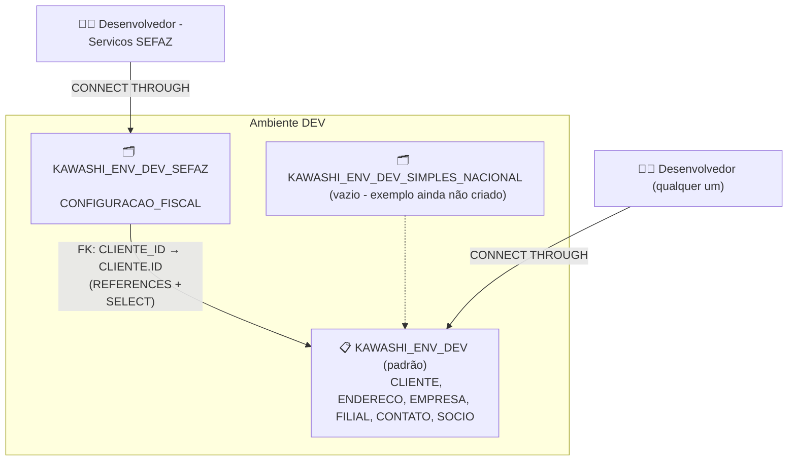
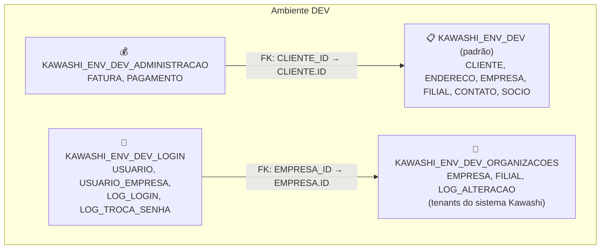

<!-- Extraido sem alteracao das secoes 2.1 e 2.2 de infra/docs/arquitetura.md, na tag dominio-completo-pre-separacao do repositorio de regras. Os diagramas e bullets abaixo descrevem o dominio de exemplo completo (padrao + SEFAZ/SIMPLES_NACIONAL + ORGANIZACOES/LOGIN/ADMINISTRACAO). -->

## 2.1 Segmentação por serviço DENTRO de cada ambiente

Além da divisão por estágio de ciclo de vida, cada ambiente acima tem uma segunda camada: tabelas
**padrão** (compartilhadas, ex: `CLIENTE`) e schemas de **serviço** (ex: `SEFAZ`,
`SIMPLES_NACIONAL`) com tabelas específicas que referenciam o padrão via FK, mas só são visíveis
a quem tem liberação explícita pra aquele serviço (parâmetro `-Servicos` do onboarding, aditivo e
independente do perfil). O exemplo abaixo usa o ambiente DEV, mas o mesmo desenho existe em cada
um dos 6 ambientes:

**O que prestar atenção aqui:**
- A FK é **só de ida**: o schema de serviço referencia o padrão (`SEFAZ.CONFIGURACAO_FISCAL.CLIENTE_ID
  → KAWASHI_ENV_DEV.CLIENTE.ID`) - o padrão nunca sabe que SEFAZ existe, nem referencia nada nele.
  Isso é o que mantém o padrão reutilizável por qualquer serviço novo sem precisar mudar nada nele.
- `REFERENCES` sozinho só permite **criar** a FK - não dá privilégio de leitura nenhum (achado
  real, ver item 17 de [`bugs-primeiro-teste.md`](bugs-primeiro-teste.md)). Por isso o schema de
  serviço também recebe `GRANT SELECT` em todas as tabelas padrão do ambiente.
- Ter `-Servicos SEFAZ` não dá acesso a `SIMPLES_NACIONAL` de brinde - a liberação é estritamente
  por serviço, nunca "tudo ou nada".
- Fora do escopo por enquanto (ver `bugs-primeiro-teste.md`): sincronizar automaticamente a
  estrutura de uma tabela de serviço entre ambientes conforme ela é promovida (TESTE_DEV → DEV →
  HOMOLOG → PROD) - por isso as tabelas de exemplo hoje só existem em `TESTE_DEV`/`DEV`, não nos
  outros 4 ambientes (que já têm os schemas de serviço criados, vazios, prontos pra isso).

## 2.2 Mais exemplos ilustrativos do mesmo padrão (ORGANIZACOES, LOGIN, ADMINISTRACAO)

Além de SEFAZ/SIMPLES_NACIONAL, três outros schemas de serviço foram criados só como mais
referência e material de teste do mesmo padrão padrão+serviço — sem aprofundar o desenho de
nenhum deles (decisão explícita: "não vamos nos aprofundar em nenhum esquema, só por eles pra
gente ir usando como exemplos e testes"). Também em `TESTE_DEV`/`DEV` apenas, mesma lógica da
seção 2.1:

**O que prestar atenção aqui:**
- `ORGANIZACOES.EMPRESA` (os *tenants* que usam o sistema Kawashi) **não é a mesma coisa** que
  `EMPRESA` do schema padrão (que representa uma empresa do CLIENTE fiscal, usada por
  SEFAZ/SIMPLES_NACIONAL) — são dois conceitos diferentes, em schemas diferentes, sem nenhuma
  relação entre si. Só compartilham o nome por coincidência de domínio.
- `LOGIN` modela uma pessoa podendo pertencer a mais de uma organização com um papel diferente
  em cada uma (`USUARIO_EMPRESA`, N:N) — ela escolhe com qual organização quer logar depois de
  validar email+senha. `LOG_LOGIN`/`LOG_TROCA_SENHA` guardam só o histórico; a regra em si (2FA,
  forçar troca a cada 3 meses) é lógica de aplicação, fora do escopo de uma tabela de exemplo —
  mesma filosofia do projeto inteiro de nunca guardar segredo de verdade em texto puro no banco.
- `ADMINISTRACAO` referencia o `CLIENTE` do schema padrão — o **mesmo** `CLIENTE` que SEFAZ já
  referencia. Prova concreta de que o padrão é reutilizável por um serviço novo, inclusive um que
  não é fiscal, sem precisar mudar nada nele.
- Nenhum `-Profile`/`-Servicos` de `create-team-member.ps1` concede acesso a estes 3 schemas
  ainda — por enquanto existem só como exemplo e material de teste de arquitetura (ver
  `infra/tests/caixa-branca/Test-InvarianteFkPadraoNuncaReferenciaServico.ps1`, que confirma que
  a FK entre padrão e serviço nunca existe no sentido contrário, em nenhum dos 6 ambientes).
